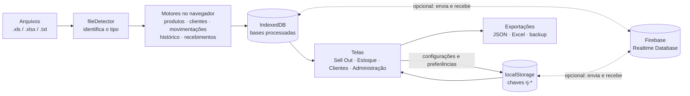

# Red Jacket

Painel comercial web para execução de vendas. O usuário importa planilhas (Excel/XLS e alguns TXT legados); o Red Jacket processa e cruza esses arquivos no próprio navegador e apresenta sell-out, estoque, carteira de clientes, pirâmide e sortimento.

- **Site publicado:** <https://luisfernandotriunfante-bit.github.io/blue-jacket-next/>
- **Nome do repositório:** `blue-jacket-next` é um nome histórico. O nome oficial do produto é **Red Jacket**. O caminho `/blue-jacket-next/` continua sendo usado só como rota de publicação no GitHub Pages.

> Não adicione dados comerciais ao repositório. `.env`, `.env.local` e `arquivos/` estão ignorados; planilhas fora dessa pasta não são ignoradas automaticamente. A revisão do histórico Git permanece pendente (veja o [HANDOFF.md](HANDOFF.md)).

## O que o painel faz

A navegação lateral tem cinco seções. Cada uma abre telas próprias:

| Seção | Telas | Para que serve | Código |
|---|---|---|---|
| **Sell Out** | Dashboard, Gerencial, Clientes | Indicadores de sell-out, visão gerencial e leitura por cliente | `SellOutTab.tsx`, `GerencialTab.tsx`, `ClientesTab.tsx` |
| **Estoque** | (tela única) | Estoque, notas recebidas e chegada de notas | `StockTab.tsx` |
| **Clientes** | Carteira, Cadastro, Pirâmide, Sortimento | Gestão da carteira, cadastro, pirâmide de premissas e análise de sortimento por canal | `CarteiraTab.tsx`, `CadastroClienteTab.tsx`, `PiramideTab.tsx`, `SortimentoTab.tsx` |
| **Campanhas** | (placeholder) | Ainda **não implementado**: a tela só exibe "em construção" | `CampaignTab.tsx` |
| **Administração** | Uploads, Auditoria, Configurações, Vendedores, Dados | Importar e processar arquivos, conferir avisos, ajustar parâmetros, cadastrar vendedores (RCA) e diagnosticar as bases | `App.tsx`, `RcaManager.tsx` |

Também há tema claro/escuro e competências mensais: em Configurações é possível abrir uma competência (`AAAA-MM`) e fechá-la, o que salva uma fotografia somente leitura dos dados, consultável depois em "Ver histórico".

## Jornada de uso

1. **Importar:** em Administração › Uploads, arraste ou escolha os arquivos. O tipo é reconhecido pela estrutura e pelo conteúdo, não pelo nome do arquivo.
2. **Processar:** cada motor lê seus arquivos e monta uma base canônica.
3. **Auditar:** em Auditoria ficam os avisos e ações sugeridas; também é possível gerar um resumo em JSON para IA.
4. **Consultar:** as demais seções leem as bases processadas.
5. **Exportar:** cada base pode ser baixada em JSON e em Excel.

### Fontes de dados reconhecidas

Formatos aceitos: `.xls`, `.xlsx` e `.txt` (apenas os relatórios legados listados abaixo).

| Motor | Fontes |
|---|---|
| Produtos | Cadastro de produtos (286), lista SAP da indústria, estoque atual (1118), preço de venda (8011), sub-marcas (8013), sortimento por canal |
| Clientes | Cadastro de clientes (1203), carteira de clientes, roteiro geral, pirâmide ativa |
| Movimentações | Vendas atuais (8022), corte de mercadorias (1454) |
| Histórico | Vendas detalhadas do legado (`.txt`), catálogo Milênio — de-para (322) |
| Chegada de notas | Relação de notas fiscais (`.txt`), entrada de mercadoria (218), carteira SAP (Excel) |

### Exportações

- Base canônica de cada motor em JSON e em Excel (`base-canonica-*.json` / `.xlsx`).
- Resumo da auditoria para IA (`auditoria-red-jacket.json`).
- Backup em JSON (Configurações › exportar/importar): reúne as configurações locais com prefixo `rj-` e as bases dos motores `produtos`, `clientes`, `historico`, `movimentacoes` e `recebimentos`. O arquivo gerado se chama `blue-jacket-sync-AAAA-MM-DD.json`.

## Arquitetura

O Red Jacket é uma SPA (React + TypeScript + Vite) que roda inteira no navegador. **Não há servidor próprio, API REST nem autenticação de usuários.**



- Os motores ficam em `src/domain/` e as telas em `src/*.tsx`.
- IndexedDB é o armazenamento principal das bases; localStorage guarda configurações e preferências.
- A sincronização em nuvem é **opcional** e usa apenas o Firebase Realtime Database. Ela envia as configurações `rj-*` e as bases dos cinco motores acima; não presuma que absolutamente todo dado do navegador é sincronizado.

## Início rápido

Pré-requisito: Node.js `^20.19.0` ou `>=22.12.0` (exigência do Vite 8 / Rolldown no `package-lock.json`; o deploy usa Node 20) e npm.

```bash
git clone https://github.com/luisfernandotriunfante-bit/blue-jacket-next.git
cd blue-jacket-next
npm ci
npm run dev
```

Abra o endereço que o Vite mostrar no terminal. Como `vite.config.ts` define `base: '/blue-jacket-next/'`, a aplicação responde em `/blue-jacket-next/` (por exemplo, `http://localhost:5173/blue-jacket-next/`).

### Scripts

| Script | Comando real | Observação |
|---|---|---|
| `npm run dev` | `vite` | Servidor de desenvolvimento |
| `npm run build` | `tsc -b && vite build` | Checagem de tipos + build de produção em `dist/`. É o gate mínimo do projeto |
| `npm run lint` | `tsc -b --pretty false` | Apenas checagem de tipos do TypeScript. **Não é ESLint** |

Não existe script de testes: o projeto ainda não tem testes automatizados.

## Configuração do Firebase (opcional)

Sem configuração, o app funciona em **modo local**: tudo fica no navegador e o indicador de nuvem não aparece.

Para habilitar a sincronização, copie `.env.example` para `.env` e preencha as variáveis `VITE_FB_*` de um projeto Firebase com Realtime Database. A nuvem só é ativada quando `VITE_FB_API_KEY` **e** `VITE_FB_DATABASE_URL` estão preenchidos.

Cuidados:

- Nunca commite `.env` (já está no `.gitignore`).
- Como não há autenticação de usuários no app, as regras do Realtime Database precisam ser revisadas antes de apontar o app para dados comerciais reais. Essa revisão está pendente (P-01 no [HANDOFF.md](HANDOFF.md)).

## Estrutura de pastas

```text
src/
  App.tsx            shell, navegação, uploads, auditoria, configurações
  *Tab.tsx           telas (Sell Out, Estoque, Clientes, Campanhas)
  RcaManager.tsx     cadastro de vendedores (RCA)
  firebaseConfig.ts  leitura das variáveis VITE_FB_*
  styles.css         todo o CSS
  domain/            motores, detecção de arquivos, persistência e sincronização
.github/workflows/   deploy.yml (publicação no GitHub Pages)
tarefas/             especificações de tarefas
revisao/             registro de exceções de revisão
```

## Publicação

O workflow `.github/workflows/deploy.yml` roda a cada push na `main`: `npm ci`, `npm run build` e publicação da pasta `dist/` no GitHub Pages (Node 20). O workflow versionado **não injeta** as variáveis `VITE_FB_*`; um build sem essas variáveis funciona em modo local, sem sincronização em nuvem.

Não há testes automatizados, smoke test pós-deploy nem rollback automático.

## Limitações conhecidas

- Campanhas é apenas um placeholder.
- Sem testes automatizados e sem ESLint (o `lint` é só `tsc`).
- Sem servidor próprio, autenticação ou controle de acesso; os dados ficam no navegador do usuário e, quando o Firebase está configurado, também são enviados ao Realtime Database.
- Os motores reconhecem layouts de relatório específicos (colunas em posições fixas); arquivos com outro layout caem como não reconhecidos.
- Revisão de segurança do Firebase e do histórico Git ainda pendente.

## Documentação do projeto

- [HANDOFF.md](HANDOFF.md): estado atual, decisões, riscos, pendências e inventário de arquivos.
- [PROTOCOLO.md](PROTOCOLO.md): regras de trabalho, branches, revisão e publicação.
- [PADRAO-VISUAL.md](PADRAO-VISUAL.md): padrão visual e tokens de design.
- [AGENTS.md](AGENTS.md) e [CLAUDE.md](CLAUDE.md): instruções por papel para agentes de IA.
